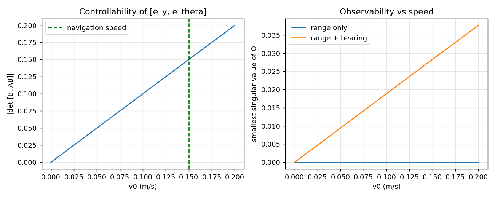
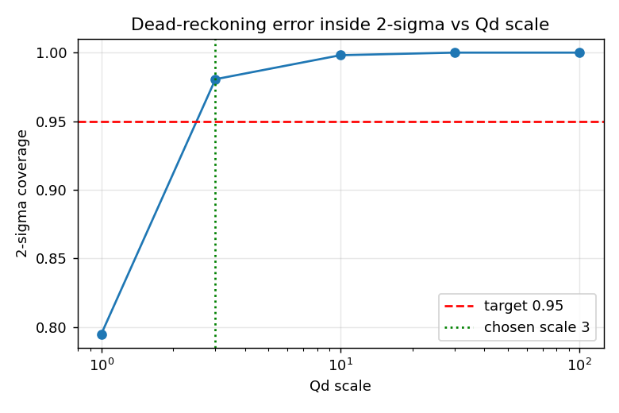
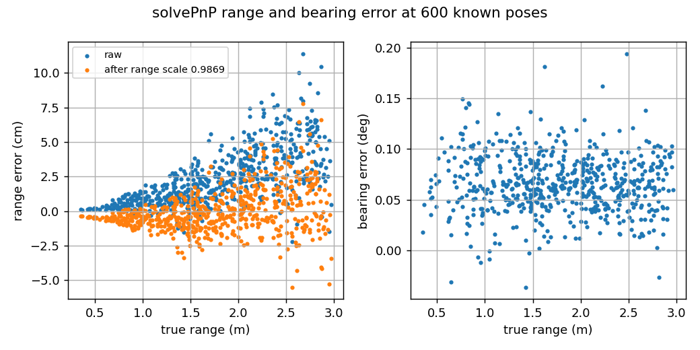

41014 Integrated Project — Track A: Visual Waypoint Navigation

**Project group:** 18

**Platform:** TurtleBot3-style differential-drive robot in MuJoCo

**Task:** Navigate around obstacles and visually dock at an ArUco-marked station.

**Video Link:** 

## Team and contributions

- **Arnav Tyagi:** Platform modelling and estimation.
- **Nivedha Suresh Balan:** Controller design, implementation, disturbed trial
- **Christian Puga:** Sensing, calibration, noise handling, frame management,
  integration and robustness.

## Project overview

The robot operates in a simulated room containing walls, randomly generated
obstacles and an ArUco marker at the docking station. The simulation includes
wheel encoders, a 72-beam 2D LiDAR and a forward-facing camera.

The intended pipeline is:

1. Read encoder, LiDAR and camera measurements.
2. Estimate the robot pose from motion and exteroceptive measurements.
3. Use the estimate and sensor measurements to navigate and dock.
4. Compare the estimate with simulator ground truth for evaluation only.

## Platform model

- **State:** position and heading `[x, y, θ]`. **Input:** forward speed `v` and turn rate `ω`.
- **Wheels → motion:** the average of the two wheel speeds gives `v`; their difference divided by the wheel gap (0.16 m) gives `ω`. Wheel radius 0.033 m, time step 0.05 s.
- **Motion model:** discrete unicycle using the exact arc each step (straight-line form when not turning). The robot can drive forward and turn but cannot slide sideways. The analytic Jacobian matches a numerical one to 1.3 × 10⁻¹⁰.
- **Measurement model:** range and bearing to the marker from the camera, which sits 0.07 m in front of the robot centre.
- **Linearisation:** about driving straight at 0.15 m/s (sympy), plus a two-state lateral/heading error model discretised with zero-order hold. The LQR is designed on this.

**Controllability:** controllable at every tested speed above zero, but not when stopped, a stopped unicycle can't correct a sideways error, so the robot lines up at the pre-dock point before slowing.

**Observability:**

| Sensors | Moving | Stopped |
|---|---|---|
| Wheels only | not observable | not observable |
| Range only | sideways position hidden | not observable |
| **Range + bearing** | **fully observable** | one hidden direction |

Range and bearing only pin down the pose while the robot is moving, which is why the camera is fused with odometry in an EKF rather than used on its own.



### Sensor configuration and calibration

- **Wheel encoders:** Gaussian noise, standard deviation 0.002 rad per reading.
- **LiDAR:** 72 beams around the robot, noise 0.01 m on valid returns. A beam with no return is set to 3.5 m.
- **Camera:** detects the ArUco marker and uses PnP with the known 0.20 m marker size to get range and bearing. Readings beyond 3 m are rejected. Intrinsics come from the simulated 640 × 480 image and 60° vertical field of view.

**Calibration**

- **Wheel radius:** straight drive for 20 s. Odometry reported 2.567 m against 2.522 m true → calibrated radius **0.03242 m**.
- **Process noise Q:** one-step motion-model error over 10 test drives, scaled ×3 so the uncertainty bound covers ≥ 95% of the error (0.98).
- **Camera noise R:** PnP compared with 600 known poses. After removing a range scale (0.9863) and bearing bias (+0.065°), the leftover noise is **1.56 cm range, 0.028° bearing**. Range noise grows with distance; bearing noise doesn't.




## Estimation and control

### Estimation (EKF)

The robot starts up to 15 cm and 10° away from its planned pose and is never told. An **Extended Kalman Filter** estimates its pose every 0.05 s:

- **Predict (always):** move the estimate using the wheel speeds and the motion model. Uncertainty grows.
- **Correct (marker seen within 3 m):** compare the camera's range and bearing with what the model expects, and nudge the estimate towards it. Uncertainty shrinks. The bearing difference is wrapped to ±180°.
- **Marker not visible:** predict only, and the uncertainty keeps growing until the next sighting.

**Results (average of 20 runs):**

| Setting | Position error | 2σ coverage |
|---|---|---|
| Wheels only (dead reckoning) | 4.5 cm | – |
| **EKF (calibrated Q, R)** | **0.6 cm** | **1.00** |
| R 10× too small | 2.3 cm | 0.79 (overconfident) |
| Q 100× too small | 4.8 cm | 0.73 (overconfident) |

The EKF cuts the error about 7×, and the true position stays inside its uncertainty bound.


### Control

The controller uses the **EKF estimate**, not ground truth.

- **Navigate:** head for the pre-dock point (1.54, 0), choosing the LiDAR-clear direction closest to the goal and slowing down when obstacles are close.
- **Dock** (within 0.25 m of pre-dock): an LQR on the lateral/heading error model holds the centre line, slowing as the range approaches 0.40 m. Gains come from Bryson's rule (5 cm, 10°), limited to ±1.2 rad/s turn rate.
- **Stop:** range within 3 cm of 0.40 m and marker centred.

**Integrated run (seed 1):** marker first seen at 11 s; docked at **30.4 s** with **0.7 cm** final estimate error and −0.2 cm lateral offset.

Ground truth is used only for post-run error plots. It is not passed to the estimator or controller.

## Integration and robustness

`src/robustness.py` supplies reproducible trial seeds, a disturbance settings
dataclass and condition-summary helpers. These helpers need to be called by the
simulation's actual trial loop for their settings to affect a run. At present,
they are **not wired into** the standalone demo. The current `main.py` expects
a different simulation API and should not be used as the entry point for this
demo.

A single successful run is a smoke test, not a repeated-trial robustness study.
For a robustness claim, run multiple baseline and disturbed trials with the
same seed list, and report success rate, pose error, collisions, and the exact
disturbances used.

## Example result from one run

One observed run of the standalone demo reported:

- Docked at 30.2 s.
- Final position error: 0.034 m.
- Mean position error: 0.020 m.
- Marker visible in 63% of control steps.
- Zero control steps reported as touching a wall or obstacle.

These are results from **one trial only**. They do not establish repeated-trial
robustness or performance under injected disturbance.

## Install and run

From the repository root, create and activate a virtual environment and install
the dependencies:

```bash
python3 -m venv .venv
source .venv/bin/activate
python -m pip install -r requirements.txt
```

Run the standalone demo:

```bash
# macOS: use MuJoCo's Python launcher for the interactive viewer
mjpython trackA.py --seed 41014

# Other platforms
python trackA.py --seed 41014
```

The demo saves its result plot as `trackA_result.png`. To run without the live
viewer:

```bash
mjpython trackA.py --headless --seed 41014
```


## Demo video

**Five-minute project demonstration:** [_Add the public video link here._](https://youtu.be/eyBObxGzX3Q)

## Repository

[Project GitHub repository](https://github.com/arnavtyagi0507-alt/Sensors-and-controls-TA)


## Generative AI declaration
CHATGPT | Mainly used for debugging the code, in the unicycle model. Also used to verify the models made in mujoco and refine, assistance for the project page.
   
